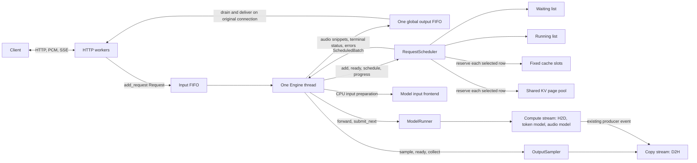
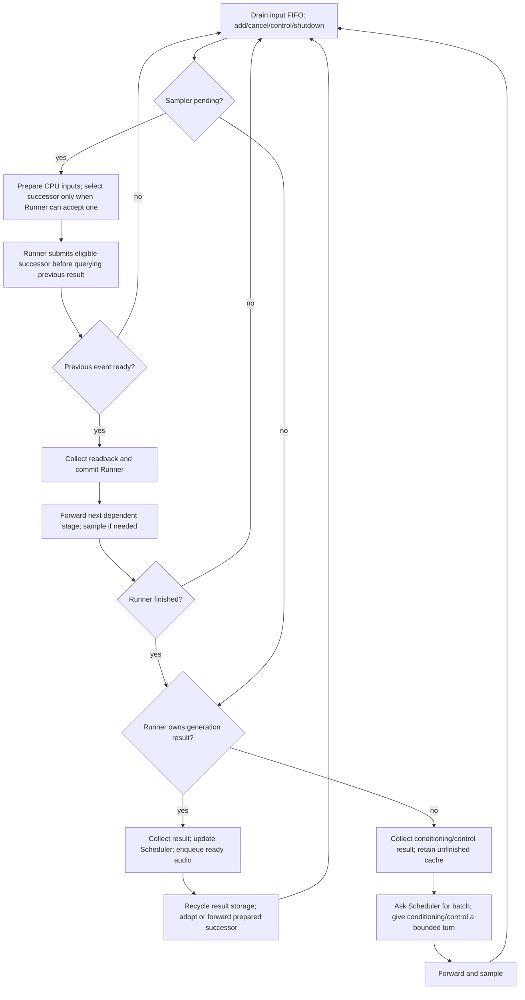

# Execution and ownership

HTTP workers share one Engine. They own HTTP parsing, framing and sockets.
Engine starts one execution thread with `run_async()` and creates no GPU worker.
Requests and results cross thread boundaries as data in queues; no cross-thread
message contains a callback.



Scheduler owns only waiting/running membership, batch limits, prefill priority and
slot/KV capacity selection. Prepared waiting requests enter the batch whenever
slot, KV and workspace constraints permit. Pending prefill rows precede decode
rows; Runner finishes all selected prefill programs before decoding. There is no
decode-time-derived prefill budget or deadline. Engine treats each scheduled batch
as opaque work; it neither checks prefill/decode membership nor decides their
priority. Controls and conditioning yield at completed program boundaries.
Already submitted GPU work completes before the next selection takes effect.
A row stays waiting until a physical slot and KV
backing are both reserved. Runner receives those resources with the row and does
not acquire a slot or return a deferred row. One waiting-list pass selects the
next batch without per-request retry epochs or deferred-input queues. There is no
RequestAdmission, request-wide row-credit pool or RequestPlanner.
Engine attaches prepared inputs, calls Runner/Sampler, processes completions,
updates Scheduler and publishes audio. Scheduler never sees PCM, network objects,
model input plans, preparation continuations or client statistics. Runner keeps
model progress counters and reports them as completion data; Engine owns client
TTFT/total time and aggregate statistics.

Runner owns each request's model cache: paged backbone KV, codec KV, convolution
history, positions, generated-code storage and RNG. Scheduler's running row,
batch snapshots and Runner's cache share the selected slot and KV reservation.
An in-flight frame also holds the cache handle. EOS removes the live row, but an
already submitted successor retains the cache until its existing completion event
is observed. Its unwanted result is
discarded, then ordinary ownership releases the slot/pages. No retirement queue or
second request-lifecycle object is needed.

## Engine loop




For causal single-frame programs, token decode and audio synthesis are submitted
on the compute stream together. There is no CPU EOS round-trip between them.
After submitting B1, Engine queries B0's event, publishes B0 and adopts B1 without
launching it again. At most one successor is outstanding. Unknown EOS can produce
one extra decoded frame; Engine discards it. Context/token capacity bounds still
apply to that extra work. New prefills, reference conditioning and controls retain
batch-boundary handling. Windowed models with true CPU-dependent audio metadata
retain their staged path.

A completed prefill returns to the ordinary Scheduler boundary before a decode
starts. Newly prepared waiting rows can therefore enter the next selection ahead
of existing decoders. Runner exposes only whether it can accept an early
successor; Engine selects one during that opportunity. It does not freeze a future
batch while Runner is still processing dependent programs. This adds no lifecycle
state, wait or prefill/decode branch to Engine.

The following shows source ordering, not measured durations or guaranteed DMA
overlap. CPU preparation/output commit can run while CUDA executes another batch.
The copy stream depends on its producer; compute never waits on the copy stream.

```text
Engine:  launch B0 | prepare/launch B1 | query/commit B0 | prepare/launch B2 | query/commit B1 | prepare/launch B3
Compute: [B0 token + audio] [B1 token + audio]          [B2 token + audio]          [B3 token + audio]
Copy:                      [B0 EOS + PCM]              [B1 EOS + PCM]              [B2 EOS + PCM]
```

Two fixed result slots keep previous EOS/PCM separate from the next model's
workspace. Sampler has one persistent pinned readback buffer and one completion
event. Existing completion events reclaim only the preceding H2D snapshot prefix,
so successor metadata remains valid. There are no additional CUDA events or waits.

Token metadata uses one fixed device allocation with typed views for sampling,
code pointers, row mapping, cache descriptors, counts and positions. Audio has a
separate allocation for code pointers, codec caches and convolution descriptors.
Each stage fills reusable CPU storage and makes one nonblocking Tensor upload,
replacing seven token uploads and three audio uploads. Separate audio storage
keeps its upload from overwriting token counters updated by the GPU. CUDA graph
addresses remain fixed; no extra D2D copies, events or waits implement this packing.
Fewer submission calls can reduce the measured metadata gap; this alone does not
establish PCM DMA/compute overlap or a throughput improvement.

Engine derives pending readback from Sampler and active preparation from Runner's
owned task batch. Runner derives active work from its owned execution/preparation/
control records. Its phase enum describes dependent model program stages.
Engine publishes directly into one plain `std::deque<GenerationFrame>` protected
by its queue mutex. It does not keep per-ID output queues, pending readers,
reader deadlines or result-routing commands. Request IDs in output records let
the HTTP owner associate audio with its existing connection; that connection's
buffer belongs to HTTP. No endpoint opens another connection to retrieve results.
Terminal producers retire request work before notifying the queue consumer.
Global queue overflow produces a terminal error without scanning or rewriting
other queued records. HTTP enforces each connection's own byte limit and cancels
a slow consumer. Admission bounds active Engine work independently of buffered PCM.

Input commands use a plain mutex-protected FIFO. Synchronous resource/control
calls enqueue typed, caller-owned records; Engine fills their result and notifies
the existing input condition variable. They carry no callback and have no private
reply queue. Reference preparation, encoding and code decoding use the same event-query,
Runner commit and dependent-stage advancement path as generation. There is no
separate active-control loop. Engine services ingress and CPU preparation while
any of those GPU programs run.

Code decoding owns one cache containing codec KV, convolution history, position,
input descriptors and accumulated audio. Each `forward_codes` submits one frame;
its completed readback releases only that frame's transient network workspace.
The cache survives while Engine runs a generation batch, then the next code frame
resumes from it. Reference preparation similarly yields between model programs.
At a control completion boundary, waiting request conditioning can run before
that control resumes; it keeps its existing slot capacity check.
The existing `generation_due` fairness flag then gives runnable generation a turn; no extra control phase enum, wait/event or suspension snapshot
implements this. A GPU program itself executes to completion before another
program uses its workspace. Engine never preempts a running kernel.

Offline `generate()` exclusively consumes the same global FIFO. It invokes its
sink on the calling thread. Cancellation discards subsequent frames through that
request's terminal record before returning, so the next call sees no stale audio.

A queued batch already owns its slot/KV resources. Engine adopts it directly;
there is no refresh/reselection pass, completion-membership gate, or separate
successor completion holder. Runner ignores rows retired by the preceding frame.
Before launching an unsubmitted batch, Engine drops rows and input plans removed
by cancellation. Submitted frames retain their exact membership until collection.
Completions requiring no GPU work stay in Runner's existing completion record and
are collected by the same Engine loop.

For PCM-producing audio programs, captured batch shapes retain borrowed output
views into the fixed graph workspace. Replay selects the matching shape's view.
The compute stream copies that view directly to this batch's result slot before
any successor can reuse the workspace. The former workspace-to-intermediate and
intermediate-to-result copies are reduced to one copy; that intermediate buffer
is not allocated. Waveform-only programs retain their necessary F32-to-PCM buffer.


## Tensor storage and public APIs

Tensor/Storage owns allocation and copying. `Tensor::to(device, true)` creates a
converted tensor; `copy_(source, true)` fills existing graph-stable storage.
Runner, Engine and models do not call `cudaMemcpy*` directly. The CUDA backend is
`ops/cuda/tensor_allocator.h`; `runtime/device.h` is a compatibility include.
H2D and kernels share the compute stream. Borrowed asynchronous D2H uses the copy
stream after the existing compute-ready event. Same-stream ordering does not
provide cross-stream dependencies automatically.

Persistent caches, graph workspaces, result slots and pinned buffers are bounded
at initialization. KV backing can grow inside the reserved runtime pool without
relocating live pages. Normal generation uses event queries. Initialization,
shutdown and exceptional cleanup drain streams before releasing storage.

CPU model formatting remains in concrete token/phoneme frontends called by Engine.
Reference conditioning can alternate CPU preparation and GPU programs through
owned records. CLI, C API and Python FFI use the same Engine as HTTP. The C++
`AudioCallback` compatibility overload retains `std::function` to preserve the
public API; its sink is invoked synchronously on the caller's thread and never
travels through an Engine queue. Template sinks avoid callable type erasure.

## Verification evidence

Build with `-DTTS_BUILD_TESTS=ON`. Existing checks cover stream/storage ordering,
Scheduler memory limits and cancellation, Engine lifecycle and greedy graph/eager
PCM equivalence. Serving checks must use batch capacity at least 16, genuinely
concurrent clients, different texts and varied duration budgets. Budgets are not
assertions of exact generated duration. Every background controller has a total
hard deadline of at most 60 seconds; do not loop or repeatedly benchmark.

For a short Nsight capture, collect CUDA/NVTX with CPU sampling disabled, export
SQLite, and use `scripts/check_engine_trace.py` and `scripts/draw_engine_trace.py`.
Use `--cpuctxsw=process-tree` to record per-thread scheduled CPU time.
Their output distinguishes actual CPU/GPU intervals and copies. Kernel/graph span
coverage is not SM utilization. CPU scheduled time includes polling and is measured
as a fraction of one core. Inspect actual overlap rather than inferring it from API ordering.

The final Breeze INT8 comparison uses H100 NVL, capacity 16, context 2048,
runtime reserve 4096 MiB and 64 HTTP workers. Each version completes 48 requests
across two waves of 16/32 genuinely concurrent client threads, released by a
barrier. All texts and audio hashes are distinct; actual output lengths span
10–100 seconds. Both versions use the same workload, seeds and options. Warmup
is excluded from the following request metrics.

| Simultaneous clients | TTFT p50, main → final (ms) | TPOT p50, main → final (ms/audio frame) | Completed QPS, main → final |
| ---: | ---: | ---: | ---: |
| 16 | 77.12 → 55.12 | 13.147 → 13.089 | 6.9827 → 7.0741 |
| 32 | 1306.34 → 1216.14 | 13.919 → 13.833 | 1.9879 → 1.9904 |

TPOT is per 80 ms audio frame, not text token. QPS includes queueing and draining;
length mixes differ between waves. This is one finite sample, not a universal
performance guarantee. Small TPOT/QPS changes can be affected by run-to-run noise.
Baseline native sources are `4fe17ae71d9b8a4e6e2abf99c0448fbc8a3aac75`, identical
in `src/` and `include/` to recorded main `37fdf3d88e176ef3edb4ccead15680efef4d7bf1`.
Both complete server runs take about 24.12 seconds, including startup and warmup.
Final client request-start spans are 1.73/3.17 ms; measured peak in-flight is 16/32.
The nonuniform workload contains mostly shorter clips and one 100-second clip.

Reproduce the two completed waves for each build separately:

```bash
python3 scripts/benchmark_server.py --build BUILD_DIRECTORY --mode int8 \
  --batch 16 --runtime-memory-mb 4096 --single-wave --simultaneous-start \
  --workload scripts/benchmark_workload.json --concurrency 16,32 \
  --max-seconds 60 --output report.json
```

A separate 4-second Nsight serving capture uses 32 simultaneous clients and capacity 16.
It intentionally closes unfinished connections and supplies scheduling/delivery
measurements, not completed QPS. Its final correctness/profile/export/analysis
controller finishes in 52.726 seconds under a hard 60-second deadline.

- 287/287 consecutive full-batch steady-state pairs submit ahead of preceding
  compute completion. Host-late submission gap p50/p95/max is 0 µs. Device span gap
  p50/p95 is 21.408/24.576 µs; initial/admission/control gaps are not claimed absent.
- 292/292 early submissions precede the preceding result's first event query.
  35 successor intervals have measured PCM DMA/compute overlap.
- Compute/graph spans cover 99.11% after first compute (97.90% of the whole serving
  window). This is not SM utilization. Engine uses 95.21% of one scheduled CPU
  core, including event polling; CPU IP sampling is disabled.
- PCM DMA completion → output FIFO p50/p95 is 584/1487 µs (max 11.157 ms).
  FIFO → HTTP dequeue p50/p95 is 64/146 µs (max 2.295 ms).
  FIFO → completed socket write p50/p95 is 100/204 µs (max 2.333 ms).
  Socket-write completion is not remote-client receipt time.
- All 4701 received client chunks match their request/frame enqueue markers;
  no HTTP dequeue lacks its preceding enqueue.
- One CUDA submission thread; compute/H2D stream 13 and D2H stream 14. No hot-path
  stream/device/event synchronize, allocation/free or graph capture/instantiate.

Four consecutive full 16-row batches have these measured intervals in milliseconds,
relative to B4 compute start. Their graph envelopes retain real durations. Negative
submission time means the work was already queued before the displayed compute.

| Batch | First host submission | GPU compute/graph | PCM D2H | CPU completion/publication |
| --- | ---: | --- | --- | --- |
| B4 | -2.283 | 0.000–12.855 | 12.872–12.875 | 12.895–13.382 |
| B5 | 11.285 | 12.875–25.735 | 25.745–25.748 | 25.765–27.111 |
| B6 | 13.434 | 25.748–38.613 | 38.626–38.629 | 38.653–39.609 |
| B7 | 27.165 | 38.635–51.503 | 51.519–51.522 | 51.540–53.355 |

B5 GPU compute is running while Engine publishes B4; B6/B7 similarly overlap the
preceding batch's CPU completion. PCM transfers are only a few microseconds and
need not overlap every successor. Already queued compute does not wait on copy.
The first two selected prefills contain 1 and 15 new rows; the first decode starts
only after both finish, with all 16 rows ready. Engine never checks their kind.

Final native lifecycle and HTTP checks pass: graph/eager exact PCM, owned request
snapshots, concurrent producers, resource-limited input waves, cancellation,
errors, queue overflow/recovery, shutdown, RNG reuse and caller-thread sinks;
chunked/nonstream PCM, SSE, WAV, disconnect and concurrent connection isolation.
Long code decoding yields while 31 generation frames complete; interleaved F32
code decoding exactly equals serial decoding. Greedy PCM hash remains
`11743693676452884642`. Scheduler resource/priority, Tensor stream/storage and
Python FIFO checks also passed before the final Engine/Runner scheduling change;
those paths were unchanged. This is not a fresh GPT/BF16/FP8 performance sample
or a full sanitizer run. Large traces, raw reports, source snapshots and binary
hashes remain local under `outputs/native_runtime/prefill-boundary-final-20261109`
in the parent workspace, consistent with the repository's media/report policy.
