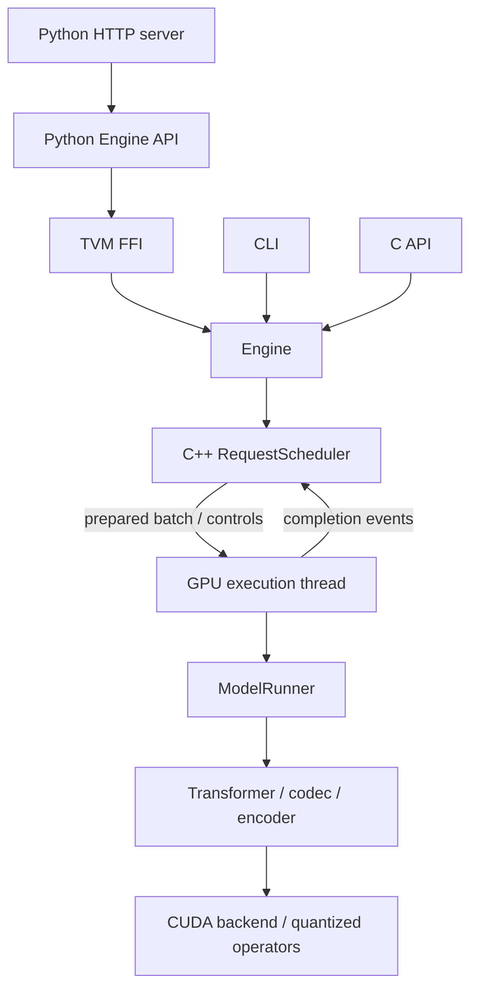

# Architecture and ownership

The engine loads the Breeze TTS 2 safetensors directly. Configuration validation
rejects incompatible checkpoints. CLI, C API and optional TVM FFI share the native
engine; the native build does not depend on Python.

## Responsibilities

| Module | Owns or controls |
|---|---|
| `tensor.h`, `kv_cache_view.h` | CUDA-independent shapes, strides and borrowed views; no allocation or implicit conversion |
| `device.h`, `tensor_storage.h` | CUDA pool allocation, move-only buffers and aligned tensor storage |
| `kv_cache.h`, `execution_resources.h` | Reusable pages, request leases, workspaces and execution resources |
| `weights.h`, `model.*`, `model_config.*` | Checkpoint validation and immutable prepared model weights |
| `model_runner.*`, `prefill.*`, `generation_state.h` | Prefill, frame generation and request state |
| `backend.*`, `quant_*.cu`, `flash_attention.*` | CUDA operators, fused producers and prepared kernel selection |
| `audio_io.*`, `audio_encoder.*`, `codec.*` | Explicit input decoding/resampling, reference codes and causal audio output |
| `engine.*` | Model/resource lifetimes and public native entry points |
| `request_scheduler.*` | CPU admission/tokenization, batch formation and lifecycle; queue-connected GPU executor |
| `c_api.cpp`, `bindings/tvm_ffi.cpp`, `main.cpp` | Independent C, Python FFI and CLI adapters |
| `python/`, `examples/server.py` | Python lifetimes/schema translation and HTTP transport |

Adapters do not select CUDA tiles or own device workspaces. The Python bridge
calls native C++ directly; it does not route synthesis through the C API.
Request admission belongs to the native scheduler. CPU selector/cache policy is separate from
CUDA launchers; model components request semantic operators.

## Allocation and execution

Weights are explicitly cast, reordered or quantized during loading, then sealed.
Inference uses prepared layouts and fused producers, without intermediate
cast/copy/contiguous adaptation kernels. Prompt metadata H2D and EOS/PCM D2H
remain explicit. PCM output conversion belongs to the output kernel.

Engine-owned device allocations use CUDA memory pools. Views never own storage.
Backbone KV uses one engine-wide physical-page pool and independent request/CFG page tables.
Admission estimates incremental KV, persistent state and workspace bytes against reusable pool
storage plus device free memory. It reserves shared KV credits for prompt plus maximum generation
length before prefill. Decode assigns page IDs as sequences grow without allocating GPU storage.
New chunks preserve live addresses; completed requests return both pages and credits. Codec ring KV,
convolution history and RNG persist in reusable request-state slots. Prefill scratch and the
batched decoder/codec workspace belong to the single runner; requests own no graph cache.
`max_batch` and `context` are limits, not worst-case preallocations.

CUDA graphs borrow workspace and page-descriptor addresses. Workspace growth invalidates
affected graphs; KV growth appends physical pages without relocating live storage. Graph keys include execution shape and prepared-kernel revisions; CFG and sampling options
reside in per-request descriptors. Steady frame execution does not relocate KV or allocate.
CUDA driver/library memory is outside the engine's pool accounting.

BF16 is the default language path; the codec retains FP32 computation. INT8/FP8
linear paths use per-channel weight and per-token activation scales. FlashAttention
remains BF16. Shape/device-dependent candidates are selected and measured during
preparation, then cached; Engine does not contain batch-specific tile tables.

## API and concurrency

Construction loads model resources without starting threads. Explicit `run_async()` starts
the scheduler and executor. Shutdown rejects new calls, cancels requests, drains accepted
messages and joins both threads. It is safe before startup and on repeat; shutdown is terminal.
The owner serializes lifecycle calls and stops ingress before shutdown.
Destruction provides the same cleanup if the caller omits shutdown.

The CPU scheduler owns request registration, tokenization, pending/active membership and
batch formation at frame boundaries. A separate GPU executor consumes the prepared batch
and returns per-lane completion events; it makes no scheduling decisions. Finished or cancelled lanes release capacity independently. Cache and codec operators
resolve request-owned state through device descriptors; batching never moves persistent
KV, convolution history or RNG state. Graphs depend on execution shape, with per-request
sampling options in device metadata. Reference handles own immutable CPU codes and transcript.
All inputs are validated and tokenized before any lane of a request executes.
Prefill and the first depth step run at admission, using shared runner workspaces.
Both actors communicate through moodycamel queues. Idle waits use semaphores with spinning
disabled, without per-request mutexes, condition variables or periodic polling.
Prepared plans move to the executor; batches and completions carry IDs and owned payloads.
Request metadata, cancellation and output buffering belong only to the scheduler.
Reference encoding and explicit codec operations also execute on the GPU executor.
The engine owns requests indexed by caller-supplied IDs; submission returns no handle.
Terminal reads consume registry entries; cancellation discards unread output and wakes readers.
Result reads are scheduler queries with reply queues; callers never access live request state.
Python only submits requests and receives bounded audio output.

The C API catches exceptions at its boundary. C callbacks borrow PCM until return
and return nonzero to cancel. Python callbacks receive PCM bytes and return
`False` to cancel. Do not reenter or destroy an engine from its callbacks.
Keep the engine resident to reuse weights, pages and captured graphs.

`tests/test_architecture.py` guards module dependencies and the pool allocation
boundary. Native tests cover tensor/configuration contracts, KV reuse, quantized
operators and resources; Python tests cover FFI, reference/batch parity and HTTP.
Profiling and numerical validation commands are in the [README](../README.md).
