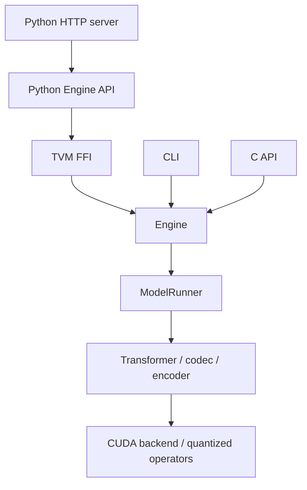

# Architecture and ownership

The engine loads the Breeze TTS 2 safetensors directly. Configuration validation
rejects incompatible checkpoints. CLI, C API and optional TVM FFI share the native
engine; the native build does not depend on Python.

## Responsibilities

| Module | Owns or controls |
|---|---|
| `tensor.h`, `kv_cache_view.h` | CUDA-independent shapes, strides and borrowed views; no allocation or implicit conversion |
| `device.h`, `tensor_storage.h` | CUDA pool allocation, move-only buffers and aligned tensor storage |
| `kv_cache.h`, `execution_resources.h` | Reusable pages, request leases, workspaces and execution resources |
| `weights.h`, `model.*`, `model_config.*` | Checkpoint validation and immutable prepared model weights |
| `model_runner.*`, `prefill.*`, `generation_state.h` | Prefill, frame generation and request state |
| `backend.*`, `quant_*.cu`, `flash_attention.*` | CUDA operators, fused producers and prepared kernel selection |
| `audio_io.*`, `audio_encoder.*`, `codec.*` | Explicit input decoding/resampling, reference codes and causal audio output |
| `engine.*` | Model/resource lifetimes, execution serialization and orchestration |
| `c_api.cpp`, `bindings/tvm_ffi.cpp`, `main.cpp` | Independent C, Python FFI and CLI adapters |
| `python/`, `examples/server.py` | Python lifetimes/schema translation and HTTP admission/transport |

Adapters do not select CUDA tiles or own device workspaces. The Python bridge
calls native C++ directly; it does not route synthesis through the C API.
HTTP admission belongs to the server. CPU selector/cache policy is separate from
CUDA launchers; model components request semantic operators.

## Allocation and execution

Weights are explicitly cast, reordered or quantized during loading, then sealed.
Inference uses prepared layouts and fused producers, without intermediate
cast/copy/contiguous adaptation kernels. Prompt metadata H2D and EOS/PCM D2H
remain explicit. PCM output conversion belongs to the output kernel.

Engine-owned device allocations use CUDA memory pools. Views never own storage.
Backbone KV uses reusable pages with independent block tables per sample/CFG lane;
codec KV uses a causal ring. Requests lease pages and return them after GPU completion,
including cancellation. Admission grows retained capacity at idle boundaries.
`max_batch` and `context` are limits, not worst-case preallocations.

CUDA graphs borrow workspace/KV addresses. Storage growth invalidates affected
graphs before reuse. Graph keys include execution shape, CFG/sampling state and
prepared-kernel revisions. Steady frame execution does not relocate KV or allocate.
CUDA driver/library memory is outside the engine's pool accounting.

BF16 is the default language path; the codec retains FP32 computation. INT8/FP8
linear paths use per-channel weight and per-token activation scales. FlashAttention
remains BF16. Shape/device-dependent candidates are selected and measured during
preparation, then cached; Engine does not contain batch-specific tile tables.

## API and concurrency

Each engine serializes calls. A call executes a real GPU batch with independent
EOS per lane; completed lanes remain in the fixed compute shape. This is not
continuous batching. Reference handles own immutable CPU codes and transcript;
prepared references can be reused without re-encoding during synthesis.

The C API catches exceptions at its boundary. C callbacks borrow PCM until return
and return nonzero to cancel. Python callbacks receive PCM bytes and return
`False` to cancel. Do not reenter or destroy an engine from its callbacks.
Keep the engine resident to reuse weights, pages and captured graphs.

`tests/test_architecture.py` guards module dependencies and the pool allocation
boundary. Native tests cover tensor/configuration contracts, KV reuse, quantized
operators and resources; Python tests cover FFI, reference/batch parity and HTTP.
Profiling and numerical validation commands are in the [README](../README.md).
